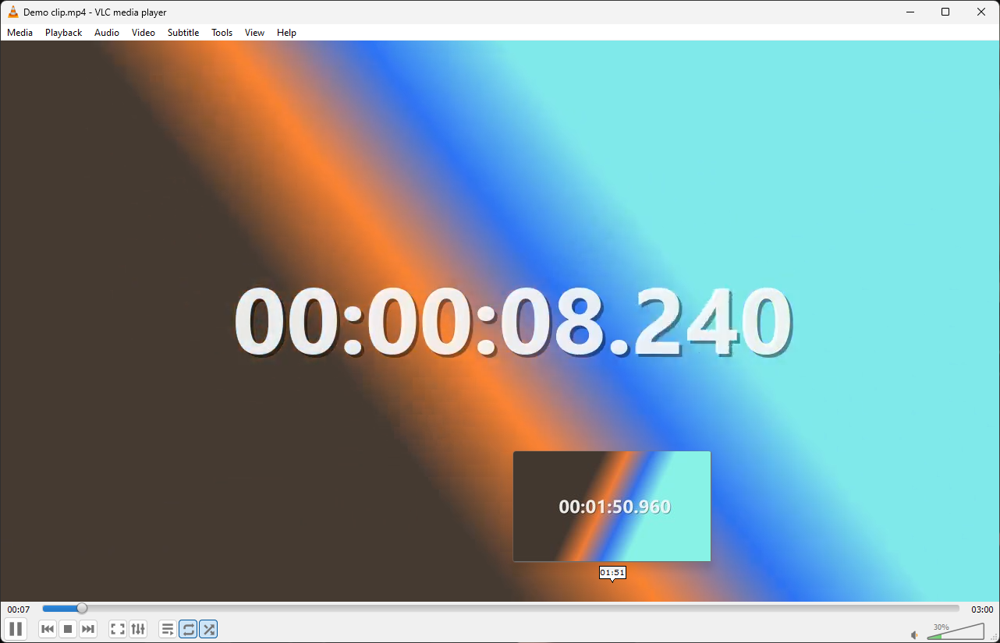

# TickPlayer

**Seekbar thumbnail previews for VLC media player on Windows.** Hover over the
seek bar and see that moment of the video, like on YouTube.



- Live previews while you hover, in a normal window and in fullscreen
- Uses your VLC's own decoder, so anything VLC plays from disk can be
  previewed. No FFmpeg, no Python, nothing else to install
- Thumbnails are cached, so reopening a video is instant
- Works with multiple monitors and display scaling
- Small (about 60 KB), installs per user without admin rights, and makes no
  network connections

## Requirements

- Windows 10 or 11
- VLC 3.0.x, 64-bit or 32-bit, with the standard interface (not a skin)
- Video files on your computer or a network share (not streams or discs)

## Install

1. Download `TickPlayer-<version>.zip` from the
   [Releases](https://github.com/Skora120/TickPlayer/releases) page.
2. Extract the zip.
3. Close VLC and double-click **`install.cmd`**.
4. Start VLC, open a video and choose **View → TickPlayer**.

To install by hand instead, copy `tickplayer.lua` and the `tickplayer` folder
into `%APPDATA%\vlc\lua\extensions\` (create the folder if it does not exist).
The `.lua` file must sit directly in `extensions`, not in a subfolder. Before
extracting, right-click the zip, choose **Properties** and tick **Unblock**, or
Windows may show a security warning when VLC starts the helper.

## Use

- **View → TickPlayer** turns previews on (a check mark appears). Choose it
  again to turn them off.
- VLC does not remember extensions between sessions, so turn TickPlayer on
  each time you start VLC.
- The first time you hover over a new video you may see "Loading preview…"
  for a moment. Thumbnails then appear as you move along the bar.

## Uninstall

Run `uninstall.cmd` from the zip, or delete `tickplayer.lua` and the
`tickplayer` folder from `%APPDATA%\vlc\lua\extensions\` and the cache folder
`%LOCALAPPDATA%\TickPlayer`.

## Troubleshooting

| Problem | What to do |
|---|---|
| TickPlayer is not in the View menu | Check that `tickplayer.lua` is directly in `%APPDATA%\vlc\lua\extensions\`, then restart VLC. |
| "TickPlayerHelper.exe was not found" | The `tickplayer` folder must be next to `tickplayer.lua`. Extract the whole zip. |
| No preview appears | Previews work for local files only, and not with VLC skins. Check the log at `%LOCALAPPDATA%\TickPlayer\helper.log`. |
| A console window flashes when turning it on | VLC extensions can only start programs through the command prompt. It is harmless. |
| SmartScreen or antivirus warning | The helper is not code-signed. `install.cmd` removes the "downloaded from the internet" mark. You can also build it yourself (see below). |
| TickPlayer appears twice in the View menu | Another `tickplayer.lua` exists in VLC's program folder (`C:\Program Files\VideoLAN\VLC\lua\extensions`). Delete one of them. |

Found a bug? [Open an issue](https://github.com/Skora120/TickPlayer/issues)
and attach `%LOCALAPPDATA%\TickPlayer\helper.log`.

## How it works

VLC's Lua extension API cannot see the mouse or draw over VLC's interface, so
a pure extension cannot do this. TickPlayer has two parts:

1. **`tickplayer.lua`**, a VLC extension. When you turn it on, it starts the
   helper and writes the URI of the playing media to a small session file
   (in `%APPDATA%\vlc\tickplayer`). It updates the file when the media
   changes, and tells the helper to stop when you turn it off.
2. **`TickPlayerHelper.exe`**, a small .NET Framework 4.8 program (.NET
   Framework 4.8 is part of Windows 10 and 11). It:
   - finds VLC's seek bar with Windows UI Automation. VLC's Qt interface
     exposes its sliders to accessibility tools, and the seek bar is the
     widest one;
   - converts the mouse position to a time with the same formula VLC uses
     for its own time tooltip;
   - decodes frames with a hidden libVLC player loaded from your VLC
     installation, seeking to exact times;
   - shows them in a borderless window that never takes focus or clicks.

   It exits when you turn the extension off or close VLC.

TickPlayer does not change any VLC settings.

## Limitations

- **Windows only.** VLC on macOS uses a native interface instead of Qt, and
  Linux would need an AT-SPI version of the seek bar lookup. Contributions
  are welcome.
- **VLC 3.0.x.** VLC 4 has a new interface and has not been tested.
- The skins interface is not supported.
- Network streams, DVDs and other non-file media are not previewed.

## Building from source

You need Windows and the [.NET SDK](https://dotnet.microsoft.com/download)
6 or newer (only for building).

```powershell
powershell -ExecutionPolicy Bypass -File scripts\build.ps1
```

This builds the 64-bit and 32-bit helpers and creates
`dist\TickPlayer-<version>.zip`.

To check thumbnail generation on its own:

```powershell
helper\bin\x64\Release\TickPlayerHelper.exe --test-thumbnails "C:\Program Files\VideoLAN\VLC" "file:///C:/Videos/movie.mkv" thumbtest
```

It saves 20 frames and the timings to `thumbtest\report.txt`.

### Releasing

1. Update the version in `helper/TickPlayerHelper.csproj` and
   `extension/tickplayer.lua` (the build fails if they differ), and add an
   entry to `CHANGELOG.md`.
2. Push a tag such as `v1.0.1`. GitHub Actions builds the zip and publishes
   the release.

### Layout

```
extension/tickplayer.lua   the VLC extension
helper/                    TickPlayerHelper (C#, .NET Framework 4.8)
scripts/                   build, install and uninstall scripts
.github/workflows/         CI build and release
```

The first commit contains the original prototype: a Python overlay that
guessed the seek bar's position from screen pixels.

## License

[MIT](LICENSE)
